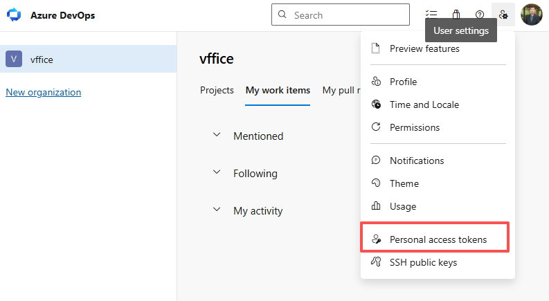
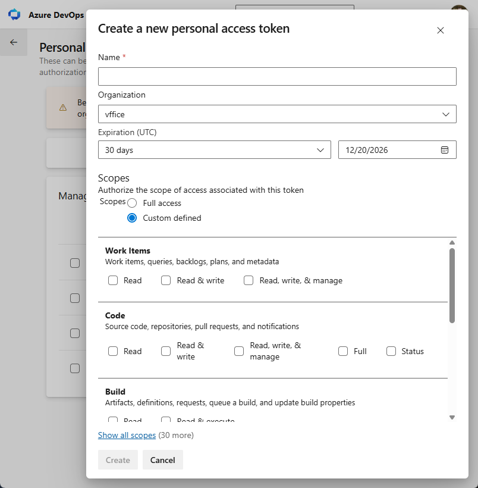
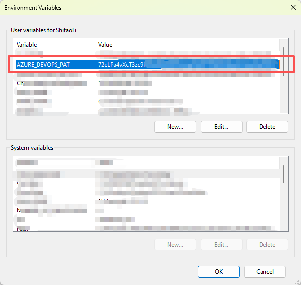

# DevOps Connector

Bring Azure DevOps work items directly into your VS Code workspace as clean, structured Markdown files. Review requirements offline, preview remote updates with side-by-side diffs, protect local edits, and translate work items into Chinese without leaving your editor.

## Key Features

- **Import Work Items as Markdown**: Export any Azure DevOps work item by ID or URL into your workspace, including title, metadata, Description, Specifications, Acceptance Criteria, Design, Repro Steps, and Comments (newest first).
- **Automatic Image Download**: Embedded HTTPS images in work item fields and comments are downloaded locally into an `images/` subfolder with relative Markdown links.
- **Safe Sync & Diff Preview**: Check for remote changes, inspect read-only diffs before updating, and sync individual items or all tracked items in batch.
- **Local Edit Protection**: Detects unsaved editor changes and local file modifications so a sync never silently overwrites your notes.
- **Translate to Chinese**: Translates `workitem.md` into Simplified Chinese in section-aware chunks using the VS Code Language Model API (`vscode.lm`), saving `workitem.zh-CN.md` alongside the original without affecting sync tracking.
- **Secure Credential Storage**: Stores your Azure DevOps Personal Access Token (PAT) per workspace folder and organization in VS Code `SecretStorage`, or falls back to the `AZURE_DEVOPS_PAT` environment variable.
- **Cross-Project Lookup**: Configure an organization URL without a project name to import work items by ID across all projects in that organization.

## Getting Started

1. **Open Configuration**
   Press `Ctrl+Shift+P`, search for **DevOps Connector: Configuration** (or click the gear icon in the Explorer title bar). In a multi-root workspace, select the target folder.
2. **Configure Connection & Save Directory**
   - **Organization or project URL**: Defaults to `https://vffice.visualstudio.com`. Leave **Project name** blank to look up work items by ID across projects, or enter a project name to restrict imports to one project.
   - **Save directory within the workspace**: Defaults to `.vscode/docs/workitems`.
   - Click **Save connection**.
3. **Set Your Personal Access Token (PAT)**
   Click **Set or replace PAT** and paste a token with **Work Items (Read)** permission. If you remove the stored PAT, the extension will fall back to the `AZURE_DEVOPS_PAT` environment variable if set.
4. **Import a Work Item**
   Open the Command Palette (`Ctrl+Shift+P`), run **DevOps Connector: Import Work Item**, and enter a work item ID (e.g. `20200`) or full Azure DevOps work item URL.

### Creating an Azure DevOps PAT

1. Sign in to Azure DevOps, select **User settings** in the top-right corner, and open **Personal access tokens**.

   

2. Choose **New Token**, set a name, organization, and expiration, select **Custom defined** under **Scopes**, and check **Work Items -> Read**.

   

3. Copy the generated token and enter it via **Set or replace PAT** in the extension configuration page. Alternatively, set `AZURE_DEVOPS_PAT` in your user environment variables (and restart VS Code).

   

## Commands

Open the Command Palette (`Ctrl+Shift+P`) and type `DevOps Connector` to access:

| Command | Description |
|---|---|
| **Configuration** | Configure the Azure DevOps organization/project URL, save directory, and PAT. |
| **Import Work Item** | Import a work item by ID or URL into the configured save directory and start tracking it. |
| **Show Tracked Work Items** | Browse all tracked work items in the current folder with their revision and sync status, and pick an action (open, translate, sync, diff, or untrack). |
| **Sync Work Item** | Check a tracked work item for remote updates, preview changes if desired, and update the local `workitem.md`. |
| **Sync All Work Items** | Check and update all eligible tracked items in batch while skipping conflicts and reporting a summary. |
| **View Remote Changes** | Open a read-only diff comparing your local `workitem.md` with the latest remote version without modifying local files. |
| **Compare with Last Synced Version** | Compare your current `workitem.md` with its last synced baseline (works offline). |
| **Translate Work Item to Chinese** | Translate `workitem.md` into Simplified Chinese using VS Code's Language Model API and save it as `workitem.zh-CN.md`. |
| **Stop Tracking Work Item** | Remove the `.devops-sync.json` tracking baseline while keeping your local Markdown files and notes. |

## Exported Folder Structure

Each imported work item is stored in its own folder under your configured save directory:

~~~text
your-project/
└── .vscode/docs/workitems/
    └── 21835/
        ├── workitem.md         # Managed Markdown copy of the work item
        ├── workitem.zh-CN.md   # Optional Simplified Chinese translation
        ├── .devops-sync.json   # Tracking metadata and last synced baseline
        ├── images/             # Locally downloaded images referenced by workitem.md
        ├── design.md           # Optional user-maintained design notes
        └── notes.md            # Optional user-maintained notes
~~~

> **Tip**: Keep your personal notes in separate files (such as `notes.md` or `design.md`) instead of editing `workitem.md` directly. If you accidentally modify `workitem.md`, **Sync Work Item** will detect the conflict and pause so you can review changes with **Compare with Last Synced Version**. If you delete `workitem.md` while keeping `.devops-sync.json`, running **Sync Work Item** will cleanly recreate it.

## Requirements, Privacy & Limitations

- **Supported Environments**: Requires VS Code **1.95.0+** in a **Trusted, file-system workspace**, connecting to **Azure DevOps Services** (`dev.azure.com` or `visualstudio.com`). Self-hosted Azure DevOps Server, virtual/web workspaces, and write-back to Azure DevOps are not supported.
- **Read-Only & On-Demand**: Network requests only run when you explicitly import, check, or sync a work item. There is no background polling or telemetry.
- **Translation Requirements**: **Translate Work Item to Chinese** requires an active VS Code Language Model API provider (such as GitHub Copilot Chat) signed in and authorized in VS Code. Model requests are only sent when you explicitly run the translate command.
- **PAT Security**: Your PAT is stored in VS Code `SecretStorage` and sent only to validated Azure DevOps cloud URLs.
- **Git Hygiene**: Exported `workitem.md` and `.devops-sync.json` files may contain internal project details. Review your workspace `.gitignore` or file contents before committing them to a repository.

## License

[MIT](./LICENSE)
